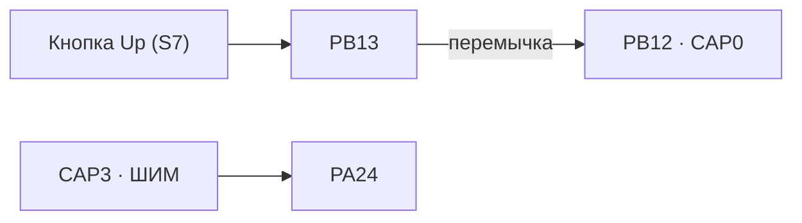

# К1986ВК01GI · захват фронтов и ШИМ

Попробуем два режима блока захвата на одной плате. **CAP0** запоминает значение счётчика по фронту и вызывает прерывание после четвёртого захвата. **CAP3** в это время выдаёт ШИМ на другом выводе, где его удобно проверить осциллографом.



## Что подключить

| Вывод | Роль в примере |
| --- | --- |
| **PB13** | GPIO. Программа формирует импульсы по нажатию кнопки **Up (S7)** |
| **PB12** | Вход CAP0. Соедините с PB13 перемычкой |
| **PA24** | Выход ШИМ от CAP3. Подключите щуп осциллографа |

В тексте статьи вход захвата назван PB13 повторно. В [исходнике](main.c) У `ImpulseIn` вывод **PB12**, у `ImpulseOut` вывод **PB13**. Для перемычки используйте эти два вывода.

## Собираем в Keil

1. Установите **Keil µVision** с **Arm Compiler 5.06**, пакет `Keil.MDR1986VK01.1.3` и CMSIS Core 5.5.0 из ARM.CMSIS 5.8.0. [Пакеты Миландр (Milandr)][software].
2. Скачайте [`PWM_support.zip`][archive] и восстановите файлы запуска из архива.

   ```console
   python tools/import_support.py PWM_support.zip
   ```

3. Откройте [PWM.uvprojx](PWM.uvprojx), соберите **Target 1** и загрузите прошивку. Если Keil предложит проверить компоненты в **Manage Run-Time Environment**, в исходном проекте используются Startup, CLK и PORT.

## На что смотреть

- **Захват.** Нажимайте **Up** и наблюдайте, как значения `TSCTR` попадают в регистры `CAP1`–`CAP4` блока CAP0. По четвёртому фронту срабатывает `CAP0_IRQHandler()`. В обработчике на время включаются три светодиода и сбрасывается флаг прерывания.
- **ШИМ.** На **PA24** наблюдайте сигнал CAP3. В исходнике `CAP1 = 100` задаёт период в отсчётах. В `CAP2` записано значение сравнения, равное 20. `CAP3` и `CAP4` дублируют эти значения. Регистры `CAP1`–`CAP4` есть в каждом блоке захвата. В примере работают два таких блока, CAP0 и CAP3.

Статью написал **Илья Лампадов**. В статье разобраны фронты захвата, полярность ШИМ и назначение регистров. [Статья и оригинальный архив][article].

[article]: https://support.milandr.ru/base/primenenie/programmirovanie-32-razryadnykh-mk/osobennosti-primeneniya-know-how/27702/
[archive]: https://support.milandr.ru/upload/iblock/905/kcggz2pscrfeqdy1scuvpfg5e916rpaf/PWM_support.zip
[software]: https://ic.milandr.ru/soft/
